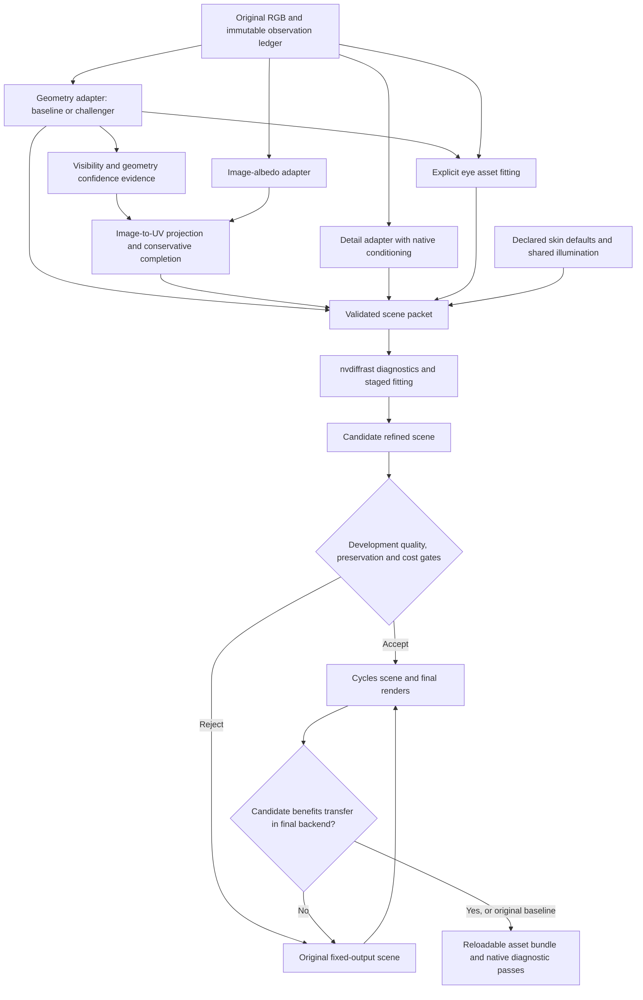
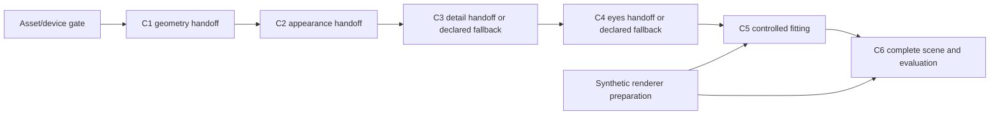

# High-level architecture

The representation for the first experiment is an explicit parametric face plus attributes. RealDenseFace is the initial candidate observer/solver. Its challenger is evaluated independently before choosing which coarse geometry feeds the integrated pipeline. All pretrained networks remain frozen; inference-time optimization updates only declared scene/fitting variables.

A component returns attributes and metadata. It never independently chooses a new head coordinate system, substitutes a new identity mesh or paints its own light into a texture without recording that decision. Unknown/occluded attributes carry validity/provenance rather than a claim of observed truth.

## Ownership and environments

| Boundary | Owner | Important invariants |
|---|---|---|
| Observation and coarse geometry | C1 | Original image/crop transforms, geometry model/hash, coarse identity/expression/pose, explicit camera |
| Albedo and UV evidence | C2 | Color encoding, visibility and observed/completed masks |
| Fine height and normal detail | C3 | Units, target UV/frame, one height owner, expression condition |
| Eye objects and fit evidence | C4 | Local-to-head transforms, gaze/pupil controls, lid/socket agreement |
| Differentiable backend/refinement | C5 | Explicit shader approximation, variable bounds, baseline snapshot, losses/gradients |
| Physical shader/final scene/export | C6 | One camera/light/exposure, Principled material semantics, optics and export limitations |
| Shared contract/version and benchmark protocol | Main thread | Changes require review and consumer compatibility checks |

Use modular Python source for project-owned logic and pinned upstream adapters. Old DECA and current RealDenseFace may need separate environments. Exchange versioned artifacts via CLI/subprocess boundaries when necessary; do not resolve all dependency conflicts by unpinned global installation. Fitting requires autograd for scene variables even though network weights are frozen; pure inference can use inference/no-grad modes only where appropriate.

The final asset contains a parametric base and declared expression controls, optional displacement/detail maps and separate eyes. A subdivided/render mesh can be generated for quality without pretending its vertices are the original FLAME control mesh. Exported maps retain UV, color, scale and material semantics. `.blend` is the reference scene; GLB/OBJ exports have a tested supported subset.

## Component startup gates

These are implementation handoff dependencies, not mathematical requirements that skin must exist before studying a detail decoder. Independent source/fixture preparation is allowed. A failed detail gate permits a clearly labeled coarse baseline; it does not authorize using unverified maps. Fixed scene rendering is a prerequisite for judging refinement, so a minimal C6 scene is prepared before C5's real-data refinement even though the complete C6 milestone follows it.

Main-thread choices are recorded in architecture decision records. Compare alternatives with the same evidence budget; changing topology, geometry owner, camera convention, training assumption or public input interface triggers a consequential design review before integration. Sol High supports that analysis. Honor the user's scoped request for Sol XHIGH critique; further premium rounds are optional bounded consultations, not an automatic permanent supervisor.

Candidate refinement remains provisional until final Cycles checks pass on development data without further target-driven adjustment. Baseline rendering terminates after its checks; a failed refinement rolls back once to that preserved baseline, rather than re-entering an unbounded optimization loop. The complete configuration and thresholds freeze before held-out evaluation.
