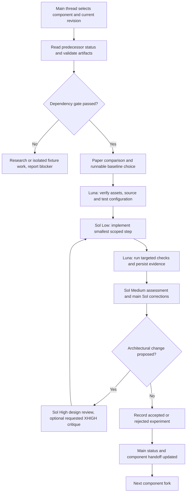

# Team roles, component chats and change control

The user's requested operating roles are below. They are an execution policy, not evidence that every model has already run. Keep one main thread as the project coordinator and source of current status; component forks consume the current on-disk plan and handoffs rather than an old copied conversation.

| Role | Work | Required output |
|---|---|---|
| Sol Low, main implementation thread | Scoped source, adapters, configs, documentation, routine fixes and integration after a concrete plan | Small reviewable change, commands, tests and component status |
| Luna High | Bounded primary-source research, checkpoint/data-access audit, notebook/test execution and artifact monitoring where tools/access permit | Sources or exact run commands, revisions, logs, saved artifacts and explicit failures |
| Sol High | Substantive research/architecture, selective consequential review and difficult diagnosis | Evidence and intent-rich recommendations; main Sol implements corrections |
| Sol Medium | Periodic plan-alignment, correctness, integration and system checks; assessment only | Findings tied to original evidence; no edits to production source, tests, notebook, dependencies or approved plan |
| Sol XHIGH | Requested or authorized bounded critique of a ready consequential architecture/research plan | Assumptions, alternatives, data/input implications, migration risks and decision recommendation |

For actual delegation in this task, Luna High maps to `gpt-6-luna` with high reasoning, and the requested Sol XHIGH review maps to `gpt-6.1-sol` with extra-high reasoning. Future main-thread model selection is an app/runtime setting; this document does not silently switch a running chat's model. Record actual model/effort for delegated reviews if auditability matters.

## One component loop

Component C1 owns geometry, C2 appearance, C3 detail, C4 eyes, C5 differentiable fitting, and C6 skin shading/final rendering. A basic C6 scene must exist to judge C5 refinement; prepare renderer fixtures early while retaining the complete C6 milestone later. The [component guides](README.md) define file/function responsibilities.

Do not automatically create six active chats or subagents. Open the next user-owned component fork when requested and its predecessor is ready. Bounded research/testing delegation can run alongside implementation when explicitly authorized. Each worker gets exact ownership and is told that others share the codebase. Do not concurrently edit shared contracts or global environments.

## Required handoff packet

Create `docs/status/C1.md` through `C6.md` during implementation, each with current status, scope, source revision/dirty state, dependency artifact IDs and versions, changed files/entry points, environment/model hashes, commands, measured results/failures, last passed gate, fallback state and next action. Main status is `docs/status/PROJECT_STATUS.md`.

Before starting a dependent component, revalidate input hashes/schema, model/UV/basis/frame/color compatibility, and predecessor's actual gate report. A status paragraph without the referenced artifact is insufficient. Keep a concrete input/output example, a minimal reproducing command and a known failure case. Refuse stale artifacts if a predecessor changed.

## Architecture decision and question records

An architecture change affects topology/model family, geometry ownership, input assumptions, shared schema/camera/color semantics, optimization policy, dataset/training regime or execution backend. Routine internal refactoring and local bug fixes do not require a new architectural ceremony. Record decisions before consumers rely on them.

Use `docs/decisions/ADR-<number>.md` with: problem/evidence, user's question or proposal, alternatives, selected change, inference inputs, training requirement, files/contracts affected, benchmark/acceptance plan, reviewer findings, migration/rollback, outcome and revisit trigger. Sol XHIGH reviews material changes. If the user invokes a review, preserve the concrete proposal and compare it; do not silently substitute a preferred architecture.

Questions belong in a small `docs/status/QUESTIONS.md` register: ID, question, origin, affected component, current evidence, decision needed, blocking/nonblocking, owner and resolution. A doubt may expose a real limitation or experiment. Do not turn every question into a required model change or novel claim.

## Review cadence and rejection log

Under the user's updated working agreement, Sol Medium assesses completed vertical slices, consequential changes and integration milestones. It returns findings to the main Sol thread, which applies justified fixes and runs affected checks. Sol High handles substantive research, selective consequential reviews and difficult diagnosis, without duplicating every Medium checkpoint. Sol XHIGH provides the requested bounded critique of this ready plan and consequential architectural proposals when authorized. Record accepted/rejected/deferred findings; another model's agreement is not empirical validation.

The main Sol thread owns broad and final repository audits, implementation, fixes, integration and delivery. Preserve its actual selected model/effort; this document cannot change it. Luna receives only bounded evidence/execution tasks, uses High, and does not become the whole-project auditor. Normally use one active delegate; at most two independent delegates when justified. Do not use a legacy Medium implementation role. Default standard speed and avoid repeated unchanged premium reviews.

A rejected candidate record includes actual attempted revision/assets/input, reason, evidence, whether limitation is fundamental, scope-specific or merely access-related, and a revisit condition. “We cannot fix every limitation” is not a sufficient reason to reject a model. An unverified checkpoint means an execution blocker, not inferior scientific quality.

Source development uses small commits once checks pass. Remote configuration/publishing follows explicit user scope; do not invent a remote URL. Before remote notebooks run, establish the authorized source remote and exact commit. Persist artifacts independently of the source checkout.
