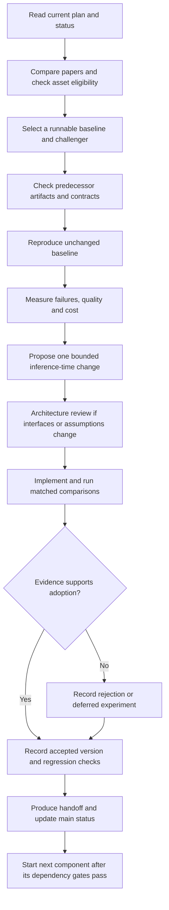

# TrueFace3D execution plan

For current scope and scheduling, use the [chapter roadmap](../../CHAPTER_ROADMAP.md). This October plan records the earlier pretrained-first design and its supporting research.

Plan version **2.0**, prepared **2026-10-23**. Target: **14 execution days**, pretrained inference and software/inference-time improvements first. No training or reconstruction has been performed for this plan. Day 1 is the actual start of execution; if it is October 23, Day 14 is November 5, 2026.

This plan supersedes the earlier documents' unrestricted multi-week schedule and their closed-model-selection wording. RealDenseFace remains the first reproduction candidate. It is not an obligatory winner after comparison. Preserve old survey documents as dated evidence. The chapter roadmap records subsequent decisions.

## Read in this order

1. [Feasibility, deliverables and scope](00_FEASIBILITY.md).
2. [Comparisons and published benchmark evidence](01_COMPARATIVE_STUDY.md).
3. [All 44 papers: baseline, improvement and ultimate use](02_PAPER_ACTION_MATRIX.md).
4. [Metrics, FLOPs and experiment protocol](03_METRICS_AND_BENCHMARKS.md).
5. [High-level architecture](04_ARCHITECTURE.md) and [low-level contracts/functions](05_LOW_LEVEL_DESIGN.md).
6. [Fourteen-day schedule and fallback decisions](06_14_DAY_ROADMAP.md).
7. [Local/Colab/Kaggle notebook specification](07_NOTEBOOK_AND_RUN_WORKFLOW.md).
8. [Agent roles, component forks, changes and questions](08_TEAM_AND_CHANGE_WORKFLOW.md).
9. [Limitations, proposed contributions and training backlog](09_LIMITATIONS_AND_NOVELTY.md).
10. Component designs: [C1 geometry](components/C1_GEOMETRY.md), [C2 appearance](components/C2_APPEARANCE.md), [C3 detail](components/C3_DETAIL.md), [C4 eyes](components/C4_EYES.md), [C5 fitting](components/C5_FITTING.md), [C6 final rendering](components/C6_RENDERING.md).
11. [Review findings and dispositions](10_REVIEW_AND_VALIDATION.md).
12. [Initial experiment cards, parametric-control tests and holdout rule](11_EXPERIMENT_CARDS.md).

The original [44-paper index](../PAPER_INDEX.md), notes/PDFs, [dataset guide](../DATASETS_AND_TRAINING.md), and [shared renderer contract](../SHARED_RENDERER_AND_CONTRACTS.md) remain supporting references. An archived note is not a current download/execution certificate.

## Main workflow

The main chat owns this chart and the decision/change registers. Component chats are opened sequentially for their own scoped work. Renderer fixtures and source research can be prepared early, but dependent integration cannot claim a passed gate without real predecessor artifacts. The user's working agreement updated during planning supersedes earlier role/teaching defaults: Sol owns implementation; Medium assesses; Luna High performs bounded operational support; High provides selective research/design and consequential diagnosis.

## What counts as progress

Each component can progress from `planned` to `assets_checked`, `baseline_reproduced`, `benchmarked`, `improvement_tested`, and `handoff_ready`. `blocked` and `deferred` are legitimate states with reasons. Record partial and failed runs. A publication table is author evidence; a screenshot is a diagnostic; a benchmark requires a saved configuration, dataset protocol and reproducible measurements.

Gate state is distinct from component progress. Required predecessor gates must be `passed` or an explicitly permitted `passed_with_fallback`; a fallback needs a reason and capability/provenance metadata. G1 always requires real parametric geometry and cannot pass with a fixture. Optional detail/eyes/refinement must either pass their enabled-input gate or be disabled with the documented fallback. Completing a comparison can pass its workflow gate even when the proposed upgrade is rejected; acceptance of an upgrade is a separate decision. See `gate_state_semantics` and `optional_inputs` in the state file.

The realistic fourteen-day result is a tested asset pipeline and a small comparative study with at most one or two well-controlled improvements. Publication-level novelty, full optical recovery and retraining six models are not acceptance requirements for this window.

Use [plan_state.json](plan_state.json) for initial machine-readable scope/gates. Its initial statuses are planned. Runtime status belongs in per-component status files and a main status ledger when implementation starts. Do not mark a model run because a document or archive validator passed.
