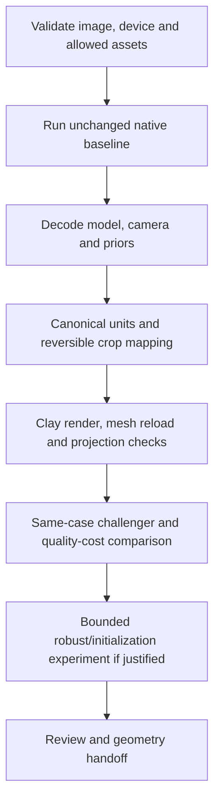

# C1: geometry

## Goal and dependencies

Produce one validated parametric face and camera from one RGB image. C1 consumes the Day 1 asset/device report and observation schema. It owns coarse identity/expression/pose and their model/basis IDs. It does not own final skin, optical eyes or appearance-based refinement.

Read [comparative evidence](../01_COMPARATIVE_STUDY.md), [metrics](../03_METRICS_AND_BENCHMARKS.md), [low-level functions](../05_LOW_LEVEL_DESIGN.md), and notes for [RealDenseFace](../../notes/01_RealDenseFace.md), [MICA](../../notes/03_MICA.md), [Pixel3DMM](../../notes/04_Pixel3DMM.md), [SMIRK](../../notes/06_SMIRK.md), [EMOCA](../../notes/08_EMOCA.md), [FlowFace](../../notes/05_FlowFace.md) and [Pix2NPHM](../../notes/44_Pix2NPHM.md).

## Comparison and mechanism

RealDenseFace is the first native baseline; Pixel3DMM is the primary challenger if its assets execute. MICA isolates neutral metric identity, while expression-focused feed-forward methods address another tradeoff. Compare native full methods first. Do not silently combine MICA shape and a different expression decoder, because model/basis/initialization changes need their own configuration and attribution.

RealDenseFace predicts correspondence, depth and uncertainty, then a CUDA Gauss–Newton fit produces FLAME parameters. Distinguish network quality, solver/initialization behavior and representation limits. The paper's training or video runtime cannot establish this installation's single-photo performance.

## Low-level responsibilities

Implement `audit_backend`, `run_native`, `decode_native`, `canonicalize_geometry`, `project_landmarks` and `export_geometry` in geometry-owned modules. Their signatures and errors are defined in the shared LLD. Preserve raw native output before conversion. An adapter returns model parameters, mesh/UV, model hash, camera/crop and available priors, not merely an OBJ.

Camera metadata distinguishes estimated calibration from known calibration. Units and axes require verified conversion. A new FLAME asset with a different expression basis is not interchangeable because a pickle filename looks similar. The original native fitting path must be traced if it differs from paper initialization.

## Experiments and gate G1

Measure neutral and posed geometry separately with valid scan/benchmark labels. Add projection, mask/silhouette where valid, failures, time/memory and operation-count coverage. Initial smoke cases check finite solver state, orientation, original-image projection, export/reload and repeatability. Isolate any new focal/robustness sweep on development data and include its full extra cost.

Pretrained uncertainty need not be calibrated under new degradations. Existing uncertainty-weighted fitting is not our novelty. Preserve unchanged weights/config and compare one change at a time; do not tune on held-out scans.

G1 requires actual baseline artifacts, camera/coordinate tests and source/device/cost evidence. Missing scan GT limits accuracy claims but does not prevent coordinate checks; record that distinction. If essential assets/backend remain unavailable after the Day 3 fallback, report the executable target blocked rather than substitute a fixture as real inference.

Save the model/basis references and named parameters needed for `regenerate_from_parameters`. Verify base regeneration, a supported pose/expression edit and reset using the [control acceptance protocol](../11_EXPERIMENT_CARDS.md). Prepare the minimal Cycles roundtrip immediately after G1, not after every specialist is complete.

Handoff: GeometryAsset/Observation/Camera manifests, priors if supported, native command/config, asset hashes, pass/failure cases and permitted consumers. Sol Low implements, Luna High audits/runs, Sol Medium assesses the completed adapter gate without editing source; main Sol applies justified fixes. A geometry-owner or representation change goes to Sol XHIGH.
