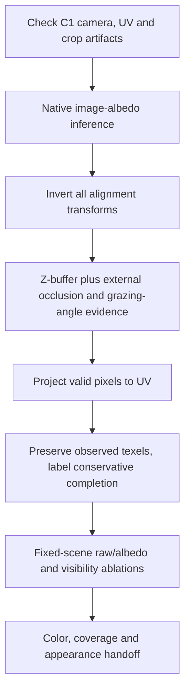

# C2: skin appearance

## Goal and dependencies

Estimate diffuse albedo where evidence permits and map it to the validated C1 surface. Consume the exact geometry/camera/crop artifacts. Do not change identity shape or interpret captured RGB as measured albedo. Read [OpenDelight](../../notes/12_OpenDelight.md), [MARCUS](../../notes/13_MARCUS.md), [MoSAR](../../notes/14_MoSAR.md), [Relightify](../../notes/15_Relightify.md), [AvatarMe++](../../notes/16_AvatarMePlusPlus.md), [ID2Reflectance](../../notes/17_ID2Reflectance.md), [ReflectanceMM](../../notes/18_ReflectanceMM.md) and [S3-Face](../../notes/19_S3Face.md).

## Comparison and mechanism

Compare raw projected-color baseline, OpenDelight image inference and one richer eligible predictor only if within budget. Image-albedo prediction and UV-PBR completion have different outputs. Preserve full coherent bundles from rich predictors for separate comparisons; do not cherry-pick best-looking maps without a compatibility experiment.

OpenDelight's image prior is compatible with one-photo inference, while the whole capture system has richer inputs. Retain the exact checkpoint's training provenance and source-token/preprocessing configuration. Color-aligned paper PSNR and raw-output PSNR are separate metrics. Generic roughness/scattering belong to declared defaults interpreted by C6.

## Low-level responsibilities

Implement `predict_image_albedo`, `compute_visibility`, `project_to_uv`, `complete_unobserved` and `validate_color` in appearance-owned files, using the shared LLD. Use the common renderer/camera conversion instead of implementing a conflicting camera. Z-buffer visibility addresses self-occlusion; hair, hands and glasses need observation masks or explicit limitations. A front-facing normal is not sufficient proof that a pixel depicts skin.

Record observed, completed and invalid texels separately. Use explicit sRGB/linear conversion exactly once, retain raw network output, and store the map's color encoding. A symmetry fill is a prior; do not replicate an observed mole onto a hidden side as fact. No arbitrary confidence value is called a calibrated probability.

## Experiments and gate G2

Hold geometry/camera/light fixed. Compare naive projection, correct visibility projection, then optional conservative reliability weighting. If adding visible-image detail residuals, test whether shadows/highlights leak back into albedo. Report coverage and skipped pixels alongside scores; a mask that excludes every difficult area cannot win without disclosure.

Use valid measured/approximate albedo labels with provenance. Include raw masked MAE/PSNR/SSIM/LPIPS, separately aligned author-style scores where reproduced, mark retention and held-out-light evidence when available. Ordinary captured texture supports projection tests, not full reflectance accuracy.

G2 requires native checkpoint inference, reversible alignment, UV/color/mask checks, fixed-scene evidence and time/memory records. With no albedo checkpoint, retain captured-color texture as a labeled fallback. With no material GT, report engineering/appearance diagnostics rather than physical parameter recovery. Retraining/new material heads stay deferred.

Handoff: image-albedo and UV maps, camera/crop linkage, color/mask/provenance, completion policy and material defaults. C6 consumes these semantics. MARCUS transfer requires topology/normal/unit validation and an architectural review. Sol Low implements, Luna runs evidence, Sol Medium assesses correctness and complexity after this milestone; Sol High handles selective consequential diagnosis.
