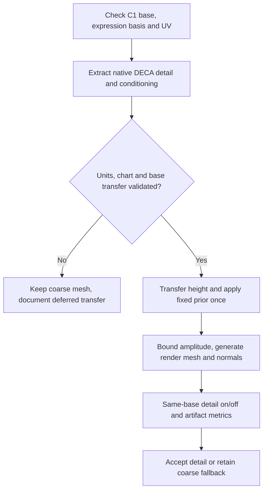

# C3: surface detail

## Goal and dependencies

Add validated fine height without silently replacing C1 identity/expression/camera. Consume the pinned base/UV/model and C2 color/shading interpretation when evaluating appearance. Read [DECA](../../notes/07_DECA.md), [HRN](../../notes/09_HRN.md), [HiFace](../../notes/10_HiFace.md), [ReEnFP](../../notes/43_ReEnFP.md), [FaceScape](../../notes/29_FaceScape.md) and [MARCUS](../../notes/13_MARCUS.md).

## Comparison and mechanism

Compare coarse-only, original DECA detail, transferred/bounded detail and optionally HRN native output. Native-model comparisons include different coarse geometry; the fixed-base comparison isolates our transfer/change. HiFace is a literature challenger until executable assets are verified. Detailed shading cannot establish that a map represents real personal geometry.

DECA's detail decoder uses a detail code plus native expression/jaw conditioning and a fixed UV prior. Keep those fields distinct. Its native shaded UV texture is not C2 diffuse albedo. Reusing coefficients from another FLAME basis by truncation is invalid without verification.

## Low-level responsibilities

Implement `extract_native`, `validate_transfer`, `transfer_displacement`, `apply_displacement` and `measure_artifacts` from the LLD. Preserve source/target model and UV IDs, fixed-prior inclusion, displacement unit scale, expression condition, masks and transfer error. Optional registration must be measured; resizing a PNG does not register another mesh.

Distinguish original FLAME control mesh from a derived subdivided render mesh. If a residual normal map is used, record its frame and whether displacement detail has already been removed from it. Do not double the same wrinkle through height plus normals. Reject inverted triangles, large unexplained silhouette/identity changes and seam discontinuities.

## Experiments and gate G3

First verify zero displacement leaves the base unchanged, known constant height moves along the intended normal, and fixed displacement is applied once. Then compare native/bounded detail under one shader and moving lights. Hair/shadow masks and amplitude policies are heuristic changes unless validated as learned confidence.

Metrics include registered scan/depth error, oriented normal angle, coarse landmark/identity drift, seam discontinuity, flips, amplitude and costs. Expression-following detail should be tested by controlled target conditions, with source-conditioning mismatch documented. Low-frequency geometric fit and high-frequency shading benefits must be separated.

G3 requires compatibility and geometry invariants plus declared quality evidence. If detailed GT is absent, restrict claims to consistency/fixtures. If transfer fails the bounded Day 6–7 attempt, keep no-detail fallback and preserve native DECA output as an independent comparison. Do not start a new decoder or unavailable HiFace training in the integration reserve.

Handoff: target DetailAsset, source/target base hashes, parameter conditioning, derived geometry/normals and an explicit on/off switch. C6 owns final shader application but C3 owns height semantics. Sol Medium assesses transfer correctness without editing source; Sol XHIGH reviews a new basis/registration strategy or competing detail owner.
