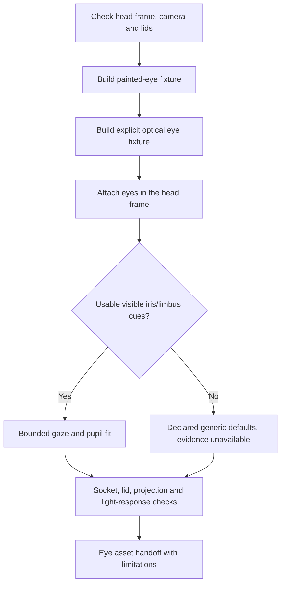

# C4: eyes

## Goal and dependencies

Add controllable explicit eyes that agree with C1 sockets/lids/camera and C6 illumination. Consume validated head transforms and visible eye cues. The initial module is a simplified procedural adaptation, not an acquired neural checkpoint. Read [high-quality eye capture](../../notes/21_EyeCapture.md), [parametric eyes](../../notes/22_ParametricEyes.md), [DeNeRF](../../notes/23_EyeNeRF.md) and optional [AudioEar](../../notes/24_AudioEar.md) for anatomical-specialist scope distinctions.

## Comparison and mechanism

An opaque painted sphere is the simple rendering baseline. Explicit sclera/cornea/iris/pupil geometry is the stronger deterministic candidate. Add bounded gaze/pupil/iris fitting only after attachment and optics fixtures work. The 2016 model's learned thirty-eye database and full code have not been verified; its exact statistical/exemplar reconstruction is deferred. Multi-camera neural eye captures have additional input/data privileges and are not equal-input competitors.

## Low-level responsibilities

Implement `make_eye_asset`, `attach_to_head`, `fit_visible_cues` and `check_socket_and_lids` from the shared LLD. Keep local/head transforms, anatomical parameter bounds, iris texture, optics defaults and observation masks explicit. Reuse C1's camera and original-coordinate ledger. Eyelids remain head geometry. Generic dimensions/optics are declared priors, not personal estimates from a tiny crop.

Fit pose/gaze before trying to change detailed shape. Bound parameters and reject fits on insufficient cues. Synthesize unresolved veins/iris fibers only as optional labeled appearance; do not interpret them as a recovered biometric fingerprint. Corneal highlights should respond to the shared scene, not be baked into the iris map. Glasses, closed lids, blur and extreme gaze are explicit failure regimes.

## Experiments and gate G4

Use known synthetic camera/eye/gaze fixtures for parameter recovery and refraction/occlusion checks. Test changed lamp/view directions and eyelid intersections. Real-image diagnostics measure visible contour/reprojection and fit rejection. Gaze/shape error is reported only if appropriate independent GT exists. Visual similarity cannot validate hidden corneal anatomy.

Compare painted sphere, explicit generic eye, then cue-fitted explicit eye under the same camera/light. Record fitting time/iterations and default versus observed parameters. G4 requires valid scene attachment, no unexplained socket/lid penetration, declared evidence and passing fixture behavior. If fitting is unreliable, ship generic explicit eyes with that limitation; do not pretend a failed fit succeeded.

Handoff includes eye meshes/materials, head transforms, cue fit/masks, generic optics and renders. Sol Low owns implementation, Luna High runs bounded fixtures, and Sol Medium checks the completed slice with evidence. Sol High handles difficult optical/integration diagnosis; a new learned eye model or geometry ownership change needs architecture review.
