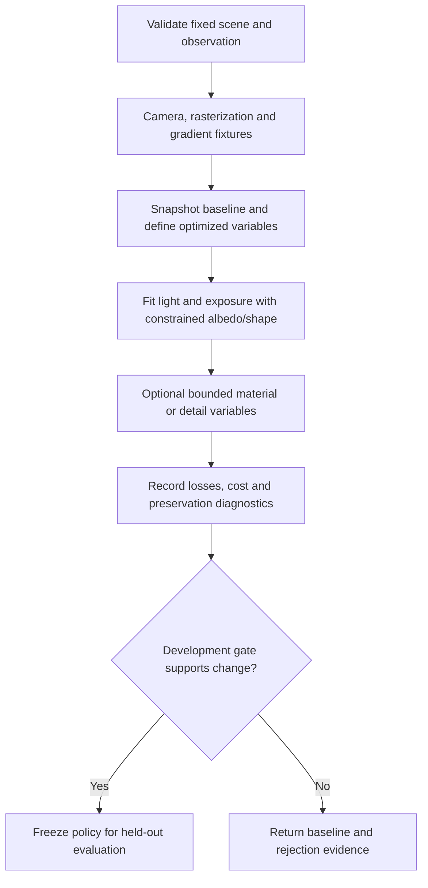

# C5: differentiable fitting

## Goal and dependencies

Provide inspectable differentiable renders and test whether bounded inference-time refinement improves a valid fixed scene. Consume C1 camera/geometry and whichever C2–C4 assets passed their gates, with fallbacks explicitly tagged. Prepare camera/rasterization fixtures early. Before real refinement, render the fixed scene through a minimal C6 path; full final-render polish comes later.

Read [nvdiffrast](../../notes/25_Nvdiffrast.md), [Mitsuba 2](../../notes/26_Mitsuba2.md), [SFDM](../../notes/40_SFDM.md), [monocular appearance capture](../../notes/41_MonocularAppearance.md), [MARCUS](../../notes/13_MARCUS.md) and [H3D-Net](../../notes/33_H3DNet.md). Consult current library documentation for APIs. Their different view/capture assumptions remain explicit.

## Comparison and mechanism

No refinement is the mandatory baseline. A robust-loss-only fit is the simple challenger; staged bounded fitting is the proposed upgrade. An unrestricted joint fit is a diagnostic comparator when feasible, not an assumed good solution. Learned physical renderers and Cycles path tracing have different transport/gradient capabilities; a shader approximation is not a complete eye/SSS differentiable solver.

## Low-level responsibilities

Implement `rasterize_scene`, `shade_differentiable`, `build_variables`, `compute_losses`, `optimize_bounded` and `select_candidate` from the LLD. Declare every optimized quantity, coordinate frame, bound, prior and stopping criterion. Frozen neural weights can coexist with differentiable scene variables; do not wrap the optimization path in global inference mode. Store each iteration's meaningful losses and reasons for invalid/empty regions.

Start with fixed identity geometry. Fix or constrain albedo while fitting light/exposure, otherwise a darker pigment and brighter lamp can compensate indefinitely. Never tune with unseen-view/light labels in the one-photo inference loop. The evaluation process consumes those targets only after the candidate/config is frozen.

Finite differences test supported smooth fixture regions. Hard visibility changes can make naive numerical gradient tests invalid; test rasterizer antialiasing/silhouette behavior separately with an explicit expected scope. Empty masks and singular/nonfinite states return explicit failures and the preserved baseline. A lower training-view photometric loss alone cannot trigger adoption as improved geometry/material accuracy.

## Experiments and gates G5a/G5b

G5a requires camera/UV/depth and gradient checks plus a small known synthetic recovery example. G5b compares fixed, robust-only and bounded staged fitting on the same development cases, with geometry/identity/held-view preservation where valid labels exist. Record all forward/backward/solver costs and failures. Lock the chosen policy before held-out evaluation; the test evaluator cannot choose the best fit per identity using test GT.

The proposed mechanism overlaps established robust optimization and staged inverse rendering. A novelty claim needs a precise additional mechanism and prior-art comparison. If no benefit is supported, keep fixed assembly and report it. Retraining a learned cross-component confidence gate is a later task.

Use the concrete [H2-v1 card](../11_EXPERIMENT_CARDS.md) for the first experiment: fixed exposure/white balance/albedo/camera/coarse controls, at most four lighting plus six valid detail amplitudes, stated normalized losses/bounds and matched iteration caps. Unrestricted giant-variable fitting is not a required strawman. Acceptance requires the candidate's preservation/quality checks to hold in Cycles as well as the approximate differentiable shader.

Handoff includes baseline and candidate ScenePackets, policy, losses/bounds, gradient fixture results, paired scores, costs and accept/reject evidence. Sol Low implements; Luna High executes; Sol Medium assesses the complete slice; Sol High handles a consequential diagnosis. Architecture changes receive the requested Sol XHIGH critique before integration.
