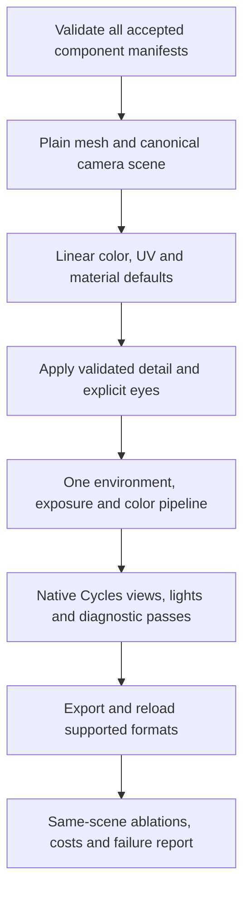

# C6: skin shading and final rendering

## Goal and dependencies

Assemble validated components into one physical scene and export a reloadable face asset. A minimal geometry/material scene is created early for integration checks; the complete C6 milestone follows component handoffs and optional C5 refinement. Consume only accepted outputs and explicitly declared fallback states.

Read [Disney shading](../../notes/27_DisneyBRDF.md), [subsurface transport](../../notes/28_SubsurfaceTransport.md), [Mitsuba 2](../../notes/26_Mitsuba2.md), [AvatarMe++](../../notes/16_AvatarMePlusPlus.md), [MARCUS](../../notes/13_MARCUS.md) and [S3-Face](../../notes/19_S3Face.md). Use the pinned Cycles version's official material/engine documentation. Old physical-model papers explain mechanisms rather than specifying current socket names.

## Comparison and mechanism

Compare captured texture/diffuse-only rendering, verified albedo with Principled material defaults, then detail/eyes and optional bounded refinement. Keep one mesh/camera/light configuration when isolating material changes. Evaluate a coherent richer material bundle only after its native inference and topology mapping pass their gates.

Subsurface transport, dielectric reflection and corneal refraction differ physically. Skin and eye shaders can differ while sharing the scene illumination. A normal map affects shading; displacement affects geometry; Principled inputs do not all equal another paper's material-map channels.

## Low-level responsibilities

Implement `assemble_scene`, `build_cycles_scene`, `render_cycles`, `export_bundle` and `verify_export_roundtrip` from the LLD. Convert coordinates once at the backend boundary and retain inverse transforms. Include map color spaces, roughness/specular interpretation, SSS scale/units, normal frame and displacement application in the scene conversion report. Apply fixed/generated detail once.

Record engine/version, device, pixels, samples, bounce settings, denoising, output color and all camera/light transforms. `.blend` retains the reference shader environment. OBJ/GLB may omit scattering, corneal optics or unapplied displacement; define and test the portable subset. A viewer displaying the asset is not proof it preserved all material semantics.

## Experiments and gate G6

Run flat-material, UV color checker, oriented normals, depth and visibility diagnostics before final beauty renders. Then compare diffuse-only versus Principled/SSS, detail on/off, eyes on/off, and no refinement versus accepted refinement. Use fixed settings and real withheld targets only under a valid matched-view/light protocol. Synthetic relighting is a consistency check, not proof of physical personal reflectance.

Measure total fresh-process inference-plus-export-plus-render separately from per-stage warm timing. Report external renderer memory with an appropriate scope; PyTorch counters do not measure Blender's full process. Native render quality remains visible if optional 2D enlargement is added later.

G6 requires a complete accepted-or-fallback scene, documented semantics, native diagnostic/beauty outputs, reloadable asset bundle and reproducibility evidence. End-to-end scientific quality remains limited by actual GT availability and exploratory sample size. Do not hold the valid pipeline hostage to an unprepared heavy MARCUS run during the last days.

Run the [parametric control/export acceptance cases](../11_EXPERIMENT_CARDS.md), including pose, expression/jaw, gaze when supported and reset. The asset must retain a tested regeneration path, even when a secondary exported format is static. Source-pose-only detail and unsupported dynamic wrinkles are explicit capabilities, not hidden animation failures. Recheck any C5 candidate under the actual final material/transport settings before adoption.

Handoff includes scene/asset manifests, .blend, supported exports, exact render command/config, same-view/light passes, limitations and runtime/memory. Sol Low integrates and delivers; Luna High runs/monitors prescribed jobs and preserves outputs; Sol Medium checks integration correctness and Sol High reviews consequential issues.
