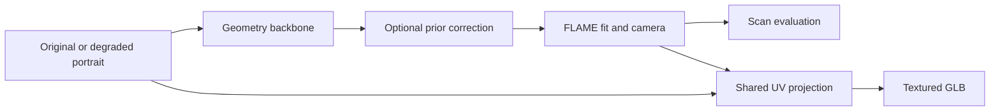

# TrueFace3D Master Plan

**23 November 2026 · Satya Srinivas Paladugu · AID24063**

**Current scope.** One portrait in, one editable face mesh out. Verify the geometric loss against a real scan before deciding whether to pursue prior correction. The immediate experiment reruns all five models on one original NoW portrait and five degraded variants, with results in [the one-photo scan error notebook](notebooks/04_one_photo_scan_error.ipynb). The texture section remains a follow-up. If meaningful geometry loss fails to repeat, evaluate color as an independent next direction. [Journal.md](Journal.md) keeps the measured evidence.

## What is already complete

- NoW validation inventory verified. There are 352 photos across 20 identities, with crop boxes, neutral reference scans and seven ordered scan landmarks.
- All five geometry variants run locally. RealDenseFace ViT-S/B, Pixel3DMM, coarse DECA and MICA produced 50 retained meshes, 50 local scan scores and 35 matched comparisons. Three subjects have original and 64 px results. One subject has the four additional resolution and blur variants.
- RealDenseFace geometry and FLAME controls, camera and UV exports, the GLB viewer, and three executed pilot notebooks are available. The MX330 passed the upstream FLAME solver, nvdiffrast and PyTorch3D CUDA probes. Existing timings, VRAM and scoped FLOPs remain in the evidence archive.
- The three-subject 64 px pilot showed no consistent increase in scan error. On the single teaching photo, ViT-S mean error rose from 1.518 mm to 1.859 mm at 32 px, a 0.341 mm gap. Heavy blur added 0.016 mm on that case. Check both severities on the remaining two development subjects before selecting a primary condition. [Pilot scores](Journal.md#three-subject-geometry-pilot-local-protocol)

## Chapter 1 — Geometry benchmark and one correction

### 1. Confirm the problem on the development cases

- [ ] Consolidate the retained pilot scores. Put original error, degraded error, the difference and fit/score counts beside each other. Inspect a real aligned scan and mesh and the score distribution. Use one fixed scan protocol across comparison rows. Use the local scorer as an explicitly labeled diagnostic until the official evaluator is qualified.
- [ ] Reuse the existing three neutral development photos. Run 32 px and heavy blur on the two additional photos with the same five baseline models. This requests up to **20 new fits** and keeps the existing 64 px rows. Use the same source photo, reference and generated input per model within a condition. Keep the crop transform and actual face width. A model that uses its native face detector keeps that policy visible.
- [ ] Select one primary degradation based on the repeatable development error, and one correction host. Prefer ViT-S when it gives a competitive geometry baseline and a usable handoff, since the existing code captures its priors and supports mesh, pose, camera and UV export. Change the host only when the benchmark and the fit interface justify it. Freeze the primary condition, data manifest, clean-quality tolerance, fit coverage and practical gain before seeing the held-out results. Keep 64 px and the other conditions as development evidence.

### 2. Test one fix against one pixel control

- [ ] For the frozen host, verify that re-injecting its unchanged priors reproduces its ordinary fit. On development, replace the suspect degraded correspondence or depth map with its clean-photo counterpart for one diagnostic run. Use matched crop coordinates, visibility and the same depth convention. This tests whether fixing that map can actually improve the mesh with the fitter held fixed.
- [ ] If the diagnostic reveals a repeatable improvement, test one small UV prior corrector on the implicated map. Freeze the backbone and fitter. Compare the **native degraded fit**, **Real-ESRGAN before fitting** as the pixel control, and **prior correction before the same fit**. Qualify Real-ESRGAN on one crop before the batch. Check the corrector on original inputs for regressions. The clean-prior substitution stays a development diagnostic. Inference uses one photo.
- [ ] Keep training and test identities separate. Run inference and final evaluation locally. Use Kaggle for any learned-corrector training only after confirming that the data, derived caches and dependencies can be used there. Keep NoW assets local pending clearance. If hosted use is unavailable, use separately licensed training pairs or limit the result to the validated geometry benchmark and controls. [NoW license](https://now.is.tue.mpg.de/license.html)

### 3. Verify on held-out people and freeze the geometry

- [ ] Use one deterministic neutral photo per remaining validation identity where eligible. Run original plus the selected primary degradation across the four faster baselines. Run Pixel3DMM on a preselected shared subset of six held-out identities to control runtime. Compare all five on the common subset. Keep the larger four-model table labeled with its cohort. The full holdout target is **up to 148 geometry baseline fits** before correction/control passes. Run one new identity first and forecast cost before submitting the rest.
- [ ] Compare the selected host's uncorrected, restored-input and corrected geometry on the same held-out photo pairs. Report per-person mean scan-to-mesh error in mm, **degradation penalty = degraded error − original error**, fit and score coverage, and added latency/VRAM. Keep median, p95, examples and the scoped GFLOP receipts in the notebook. Report repeats with a comparable timing scope. A simple warm or cold label is sufficient when an adapter cannot support both.
- [ ] Advance the correction if held-out scan error improves over the strongest eligible control and clean quality and fit coverage clear the frozen gates. If the gap fails to repeat or the correction adds no reliable benefit, document that result and carry the strongest compatible baseline into the texture study.

## Texture study — one comparison and one finished face

- [ ] Build one visibility-aware projected-RGB baseline using the selected geometry's mesh, camera and UVs. Verify projection and UV orientation on a small known example and one real photo. Save visible and filled masks with the texture.
- [ ] Qualify **OpenDelight** on one local photo, including a check on the 2 GB MX330. Compare raw projection with OpenDelight followed by the same UV projection. If OpenDelight cannot qualify, use the staged Real-ESRGAN followed by projection as the single alternative. Hold geometry and camera fixed while comparing appearance.
- [ ] Evaluate the original and selected degraded inputs on a shared subset. Use **visible UV coverage**, **SSIM** on matched visible UV crops, and side-by-side views for texture placement, seams and color shifts. Compare each degraded output with the same method's clean-photo texture as a stability reference. Treat skin color as part of this inspection. An independent skin or texture fidelity claim requires a matching reference.
- [ ] If the geometry fix passes, repeat the selected texture method on uncorrected and corrected geometry so its effect on placement is visible. Save side-by-side renders, the observed and filled masks, and an editable textured GLB. Reload the GLB and show the same view plus an alternate view.

## Checkpoint audit

| Asset on disk | Role in this scope |
|---|---|
| `checkpoints/realesrgan/RealESRGAN_x4plus.pth` | Geometry pixel-restoration control and fallback for the one texture comparator. Check local inference before using it. |
| `checkpoints/opendelight.tar` | Contains `base_delight_network.pth` and `unet_enhancer.pth`. The two files required by the default upstream test are present. Stage the archive and qualify inference when the texture work starts. |
| `checkpoints/GFPGANv1.4.pth` | Download is present. A second restorer is outside the selected comparison. |
| `checkpoints/BalanceAlb_model.npz`, two BFM-family HDF5 files, `pipeline-data.zip` and `prt-supplied-models.zip` | Present for reference. BalanceAlb is a basis, and the two ZIPs contain pipeline data and PRT models. These assets are outside the texture study's required inputs. |
| Existing geometry payloads in `third_party/` and support weights under `checkpoints/` | Previously exercised by the baseline fits. Preserve the pinned solver and runtime environments. |

The inspection verified file presence and expected archive entries. Checkout setup, preprocessing helper assets, model loading and inference for the appearance candidate are qualification steps. There are no additional manual dataset or checkpoint downloads required to start.

## Reuse and deliverables

- Keep `src/benchmark.py`, `src/evaluation.py`, `src/now_official.py`, `src/reporting.py` and `src/robustness/degrade.py` as the geometry evaluation path. Extend the existing RealDenseFace worker for the one verified correction input. Add a shared appearance projection module and one adapter once a candidate qualifies.
- Keep the three executed notebooks. Update Notebook 02 with the original geometry table and Notebook 03 with paired degradation and, when ready, the correction experiment. Use one executed texture notebook for the UV comparison and GLB. The notebooks call modules and carry the rendered outputs and terminal rerun commands.
- Update the IEEE-style journal with the frozen protocol, run IDs, matched tables, costs and failure cases. Completion means a reproducible geometry result, a tested correction or an evidence-backed decision to retain the baseline, and a reloadable textured face with a clean/degraded comparison.
- Future work includes the GARD-inspired feature adapter, a dedicated skin-color corrector, extra restoration comparisons, eyes, wrinkles and advanced lighting. The current evaluation uses the installed geometry and texture assets described above.

